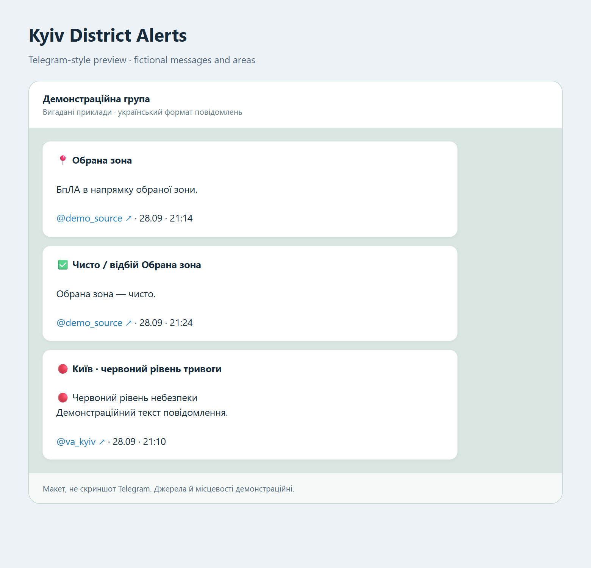

# Kyiv District Alerts

**Selected Telegram posts about your Kyiv areas, delivered to your own group.**

A local Python app that reads public Telegram channels, matches the areas you configure, and sends relevant text with a source link and Kyiv time. It also relays explicit official city alert updates and collects broader mentions into quiet digests.



*Telegram-style mockup, not a live screenshot. Fictional messages, areas and source labels. Actual notifications are in Ukrainian.*

**[See message examples](docs/MESSAGES.md) · [Start locally](#quick-start-windows) · [Linux / macOS / Docker](docs/SETUP.md) · [GCP e2-micro](docs/DEPLOY_GCP.md)**

## What arrives in your group

An area report keeps the source text and adds a clear heading:

```text
📍 Обрана зона

БпЛА в напрямку обраної зони.

@demo_source ↗ · 28.09 · 21:14
```

A local clear report has its own heading:

```text
✅ Чисто / відбій Обрана зона

Обрана зона — чисто.

@demo_source ↗ · 28.09 · 21:24
```

Explicit official city statuses are relayed separately:

```text
🔴 Київ · червоний рівень тривоги

🔴 Червоний рівень небезпеки
Демонстраційний текст повідомлення.

@va_kyiv ↗ · 28.09 · 21:10
```

These are fictional examples. In real messages the source label opens the original post. “Чисто” reflects a source report; it is not an independently verified all-clear. This app is a convenience filter, not a replacement for official air raid alerts or instructions.

## How it works

`Public Telegram channels → place-name rules → SQLite journal → your Telegram group`

- **Your chosen areas and nearby places:** relevant text goes out immediately.
- **Broader Kyiv mentions:** a silent digest, after 30 minutes or 20 items by default, only during a confirmed active city alert. Old queued items are cleared when that alert ends.
- **Official city status:** explicit yellow / red / all-clear posts from `@va_kyiv` go out immediately.
- **Edits and context:** changed relevant text can be sent again; a recent reply saying “Чисто” can inherit the parent post's area.
- **Less noise:** some brief cross-channel repeats are suppressed. This is not a guarantee of duplicate-free delivery.

The app uses explainable text rules, without an LLM. It saves source text and metadata locally; it does not download media. The first 100 recent posts per new source seed the journal without being sent to your group.

## Quick start (Windows)

You need **Python 3.14**, a Telegram account, your own Telegram API credentials, and a group that the account has joined. This uses a signed-in Telegram user account through Telethon, not a BotFather bot.

Open PowerShell and clone the repository, then install dependencies. Alternatively, download its ZIP and open PowerShell in the extracted folder, skipping the first two commands:

```powershell
git clone https://github.com/ElectronicHug/kyiv-district-alerts.git
cd kyiv-district-alerts
python -m venv .venv
.\.venv\Scripts\python.exe -m pip install -r requirements.txt
Copy-Item .env.example .env
Copy-Item config.example.yaml config.yaml
```

1. Get `api_id` and `api_hash` at [my.telegram.org](https://my.telegram.org) and fill in `.env`. Save it as UTF-8.
2. Create or choose your Telegram group. Find its ID and exact name:

   ```powershell
   .\.venv\Scripts\python.exe -m src.telegram.listener --list-groups
   ```

   The first login asks for your phone, Telegram login code and, if enabled, two-step password. Enter them locally. This command only lists groups; it sends no messages.

3. In `config.yaml`, set `output_peer_id` and `output_name`. Add your trusted public monitoring channels to `channels` and join them with the same account. Keep `@va_kyiv` for official city statuses.
4. Replace the fictional `direct` and `nearby` areas with your own place names and their common spellings. **The sample config contains no real district selection.** See [configuration examples](docs/SETUP.md#choose-your-areas).
5. Check the settings and send a connection preview:

   ```powershell
   .\.venv\Scripts\python.exe -m src.telegram.listener --check-config
   .\.venv\Scripts\python.exe -m src.telegram.listener --test-send
   ```

6. Check that the test message arrived, then run:

   ```powershell
   .\.venv\Scripts\python.exe -m src.telegram.listener
   ```

Keep the terminal and computer running. Stop with **Ctrl+C**. Only run one copy against the same group. For optional Windows autostart, Docker, troubleshooting and backups, see [setup and operation](docs/SETUP.md). To run independently of your computer, follow the [GCP e2-micro deployment example](docs/DEPLOY_GCP.md).

## Privacy and development

Your `.env`, `config.yaml`, `.local/`, Telegram sessions, logs and databases are excluded from Git. The session grants access to your logged-in Telegram account: keep it and backups private. The configured destination group receives forwarded source text and links.

No production credentials, private group IDs, selected real districts, cloud account details or collected messages are included in this repository.

Run the offline tests without Telegram credentials:

```powershell
.\.venv\Scripts\python.exe -m unittest discover -s tests -v
```

See [architecture and limitations](docs/ARCHITECTURE.md) and the [release checklist](docs/RELEASE_CHECKLIST.md). Code is available under the [MIT License](LICENSE); source channel content is not bundled or licensed by this project.
